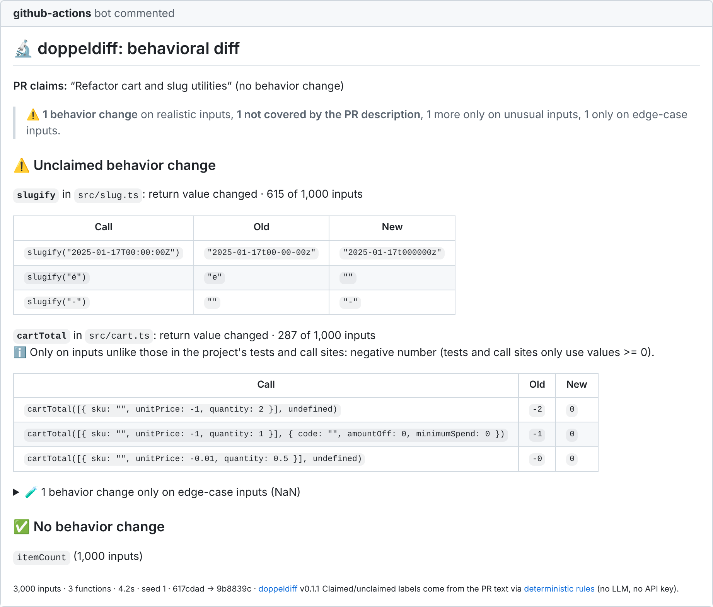
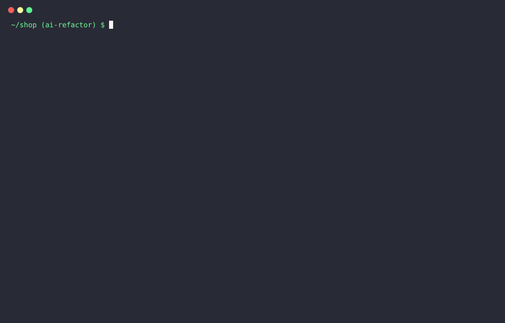

<div align="center">

# 🔬 doppeldiff

**See what your PR actually changed.**

Built for refactors and "no behavior change" pull requests. doppeldiff runs the old and the new version of every
changed function on thousands of inputs your tests never tried, and shows every input where they disagree.



```bash
npx doppeldiff
```

**No API key required. Free and fully local by default.**

</div>

### What it looks like on a real pull request

[Pull request #1](https://github.com/7suheel/doppeldiff/pull/1) is an AI-style refactor of a small shop's cart
code. Its description says _"Pure refactor, no behavior change. All tests pass."_ They do. doppeldiff ran the old and new
`cartTotal` on 10,000 generated carts and
[commented](https://github.com/7suheel/doppeldiff/pull/1#issuecomment-6560143205):

> ⚠️ **Unclaimed behavior change**: **`cartTotal`**: return value changed · 3,212 of 10,000 inputs
>
> | Call                                                                    | Old  | New |
> | ----------------------------------------------------------------------- | ---- | --- |
> | `cartTotal([{ sku: "", unitPrice: -1, quantity: 1 }], undefined)`       | `-1` | `0` |
> | `cartTotal([{ sku: "", unitPrice: -0.01, quantity: 0.01 }], undefined)` | `-0` | `0` |

The refactor clamps the total at zero, so a cart with a credit or refund line no longer adds up. No reviewer was
asked to look for that, and no test covered it. The same comment flags a second unclaimed change, in `slugify`.

## What doppeldiff is good at, and what it is not good at yet

**Good at**

- **Refactors and "no behavior change" PRs**, AI-written or not. Either it ran thousands of inputs through both
  versions and found no difference, or it shows the exact input where the refactor changed the result, like the
  `cartTotal` example above. `--refactor` (CLI) and `verify_refactor` (MCP) turn that into a pass/fail check.
- **Finding inputs your tests never tried**: negative amounts, empty and blank strings, `-0`, values just past a
  threshold in the code, strings in the formats the code's regexes parse, accents and lone surrogates. Each
  finding comes with the old and the new result and can be written out as a regression test.
- **Plain TypeScript/JavaScript functions**: utilities, parsing, formatting, money and string handling in
  libraries and app code.
- **Running on every PR**: a few seconds per PR, no API key, nothing leaves the machine.

**Not good at yet**

- **Finding arbitrary bugs.** doppeldiff only reports what differs between two versions, and random inputs rarely
  hit a change that needs several specific conditions at once (an option combination plus a particular kind of
  text). On the latest held-out set of real bug-fix commits it found **3 of 13**
  ([evaluation](docs/EVALUATION.md)). Use it next to your tests and review, not instead of them.
- **Code with side effects** (network, filesystem, databases): the sandbox blocks it, and nothing is mocked.
- **Class methods, overloaded functions, UMD bundles and class-instance parameters**: reported as not verified.
- **Callback-heavy APIs**: generated callbacks return fixed values, so a custom sort comparator never reorders
  anything.
- **"No behavior change" is evidence, not proof**: inputs are sampled, not exhaustive.

## The problem

Writing code got cheap; verifying it did not. AI-written pull requests compile, pass CI and read well, yet quietly
change behavior on inputs nobody wrote a test for. AI review bots answer with opinions ("looks good to me"), so
you end up checking one model's code with another model's guess.

doppeldiff answers with evidence instead: **"for `cartTotal([{ unitPrice: -1, quantity: 1 }])` the old code
returned `-1` and the new code returns `0`"**. You can run that example yourself, and doppeldiff can write it into
a regression test for you.

## How it works

```
 git diff ──▶ changed exported functions (+ functions that call changed helpers)
                 │
                 ▼
 base version ──▶ sandboxed Node process ─┐
                                          ├──▶ same generated inputs ──▶ compare ──▶ shrink ──▶ group
 head version ──▶ sandboxed Node process ─┘     (types + values mined         returns, throws,    minimal,
                                                 from the code + regex         mutations, async,  readable
                                                 formats + edge cases)         timeouts           examples
                 │
                 ▼
 report: terminal · PR comment · JSON · regression tests        (optional LLM: claimed vs unclaimed)
```

1. **Find what changed.** It compares each module-level declaration with comments and formatting ignored, and
   follows changed helpers, constants and imports to the exported functions that use them.
2. **Load both versions side by side.** The base commit goes into a git worktree that reuses your
   `node_modules`, and each version is bundled with esbuild (TypeScript, ESM/CJS, tsconfig `paths`, workspaces).
3. **Generate inputs.** It derives input generators from the parameter types (via the TypeScript checker,
   [fast-check](https://fast-check.dev) underneath), biased towards values mined from the code: comparison
   thresholds ±1, string literals, regex formats, property names, and boundaries such as `NaN`, `-0` and lone
   surrogates.
4. **Run both, compare everything.** It compares return values (`NaN` equals `NaN`, `-0` differs from `0`; Dates,
   Maps, Sets and class instances structurally), thrown errors, argument mutations, async results, hangs and
   crashes. The clock is frozen and randomness seeded, so the comparison is reproducible.
5. **Explain it.** Each difference is shrunk to a minimal example, made readable (`2000` instead of
   `9007199254740991`), re-run to confirm, and grouped into behaviors such as _"now returns NaN (previously a
   number)"_.

## Three scenarios

The [`examples/demo-shop`](examples/demo-shop) library ships with three pull requests. All three pass the existing
test suite.

| PR                                                            | What doppeldiff says                                                                                                                                                                                                      |
| ------------------------------------------------------------- | ------------------------------------------------------------------------------------------------------------------------------------------------------------------------------------------------------------------------- |
| **Honest fix**: "Fix discount rounding for prices over $1000" | One behavior change, only for prices above 1000: `applyDiscount(2000, 0.07)` was `1859.99`, now `1860`.                                                                                                                   |
| **"AI refactor"**: "Pure refactor, no behavior change"        | ⚠️ 3 unclaimed changes: negative totals are now clamped to `0`, `cartTotal` returns `NaN` for zero-quantity items with a non-finite price, and `slugify("é")` was `"e"` and is now `""`. `itemCount` really is unchanged. |
| **Pure refactor**: "No behavior change intended"              | ✅ No behavior change in 4 functions across 3,242 inputs. The report notes that `addBusinessDays` stopped early (242 inputs) because huge `days` values make both versions loop past the timeout.                         |

Try it: `node examples/demo-shop/try.mjs ai-refactor` creates a scenario repository and prints the command.



<sub>The image and recording above are rendered from real doppeldiff output on the demo scenario
(`scripts/render-assets.ts`); the PR comment is rendered with GitHub's Markdown stylesheet.</sub>

## Results on real commits

We ran doppeldiff on 39 historical commits from 17 libraries (ufo, validator.js, es-toolkit, date-fns, qs, radash,
…). Most are bug fixes, which is a harder test than its main use: a bug fix changes behavior on purpose, often
only for a narrow set of inputs. **The full write-up, misses included, is in
[docs/EVALUATION.md](docs/EVALUATION.md).** In short:

- **Refactors:** defu's `isPlainObject` refactor was correctly reported as "no behavior change" across 6
  functions. semver's "faster paths for compare" differs only for negative numbers, which semver never passes;
  that difference is reported but collapsed as "unusual inputs". Real refactor commits are only 2 of the 39, so
  most of the refactor evidence comes from the demo scenarios above.
- **Latest held-out set** (18 commits from 9 new libraries, picked by a fixed rule, code frozen before the run): it
  found **3 of 13** verifiable bug fixes. The run also exposed tool bugs (a CommonJS export pattern, JSDoc
  `{Object}`, cross-file impact). After fixing those, it finds 7 of 15; those numbers are no longer held out.
- On the first 21 commits it finds **11 of 13** fixes, with minimal examples. One is `withoutBase("///", "//")`, the
  protocol-relative URL that a ufo security fix was about. Another is `isISO8601("1690360")`, an ordinal date
  that a regex change started accepting.
- Most misses need two or three specific things at once (an option combination plus a particular shape of text),
  or a real callback such as a sort comparator.
- It surfaced things the commit title did not say: validator's "restrict allowed characters" also started
  accepting one- and two-character slugs.
- **Noise:** 91 % of the behaviors in the main list matter (79 % before the noise work). Differences that only
  happen on inputs unlike the project's tests and call sites are collapsed and do not fail the check.
- It **could not verify 8 of 39 commits**: class methods, overloaded functions, UMD modules, class-instance
  parameters and exported non-function values. Every report lists these explicitly.
- Each run took 0.5–8 seconds.

## Quick start

### CLI

```bash
npx doppeldiff                                  # your uncommitted changes vs HEAD
npx doppeldiff --base main                      # this branch vs main (merge base, like a PR)
npx doppeldiff --base main --claim "Fix rounding for prices over $1000"
npx doppeldiff --refactor                       # assert: no behavior change (exit 1 otherwise)
npx doppeldiff --write-tests                    # pin the examples in tests/doppeldiff/*.test.ts
npx doppeldiff --json report.json --markdown report.md
```

| Flag                                     | Default               |                                                  |
| ---------------------------------------- | --------------------- | ------------------------------------------------ |
| `--base` / `--head`                      | `HEAD` / working tree | Revisions to compare (via merge base)            |
| `--claim`, `--claim-file`, `--refactor`  |                       | What the change claims to do                     |
| `--runs`                                 | `1000`                | Max inputs per function                          |
| `--timeout`                              | `250`                 | Per-call timeout (ms)                            |
| `--budget`                               |                       | Total exploration time budget (s)                |
| `--seed`                                 | `1`                   | Every run is reproducible                        |
| `--fail-on`                              | `unclaimed`           | Exit 1 on `unclaimed`, `any` or `never`          |
| `--include` / `--exclude` / `--only`     |                       | Limit files or functions                         |
| `--no-freeze`                            |                       | Do not freeze the clock / seed randomness        |
| `--llm`, `--llm-model`, `--llm-base-url` | `off`                 | Optional LLM (below); `ollama` is free and local |

Node.js 22.13 or newer. Exit codes: `0` OK, `1` findings matching `--fail-on`, `2` tool error.

### GitHub Action

Copy the two files in [`examples/workflows/`](examples/workflows) to `.github/workflows/` on your default branch.
No secrets are required. doppeldiff posts one sticky comment per PR and updates it on every push.

It is safe for pull requests from forks. `doppeldiff.yml` runs the PR's code without secrets and with a read-only
token. `doppeldiff-comment.yml` posts the comment and never runs PR code. These have to be two files because
GitHub does not let a workflow trigger itself with `workflow_run`. See [docs/ACTION.md](docs/ACTION.md).

### MCP server for coding agents

```bash
claude mcp add doppeldiff -- npx -y doppeldiff mcp
```

Two tools: `verify_change` (what did my edit change?) and `verify_refactor` (PASS, or FAIL with
counterexamples). An agent can check its own refactor before telling you it is done. Setup for Cursor and Codex
is in [docs/MCP.md](docs/MCP.md).

### Claim matching: free, no LLM

doppeldiff compares each behavior change with the PR title and description and labels it **claimed**,
**unclaimed** or neutral, using [documented deterministic rules](docs/CLAIMS.md):

- if the PR says it is a refactor, cleanup or performance change, or says "no behavior change", every difference
  is unclaimed;
- if the PR names a function, that function's changes are claimed.

No LLM and no API key are involved.

Optionally, you can let an LLM read the description instead. A local model via
[Ollama](https://ollama.com) is free: `--llm ollama --llm-model qwen2.5:7b`. Any OpenAI-compatible server works,
and so do Anthropic or OpenAI with your own key. The LLM is never used unless you ask for it. It only labels
changes the engine actually observed, and its output is checked against the evidence. Details:
[docs/CLAIMS.md](docs/CLAIMS.md).

### Configuration (optional)

```ts
// doppeldiff.config.ts
import { defineConfig } from 'doppeldiff';

export default defineConfig({
  exclude: ['src/legacy/**'],
  compare: { epsilon: 1e-9 },
  functions: {
    // Declare the real input domain when inference from tests and call sites is not enough.
    'src/internal/identifiers.ts#compareIdentifiers': {
      where: ([a, b]) => [a, b].every((x) => typeof x === 'string' || (Number.isInteger(x) && x >= 0)),
    },
    parseConfig: { skip: 'reads files; covered by integration tests' },
  },
});
```

## Limitations

v1 is deliberately narrow. Known gaps:

- **Exported functions only.** It does not test class methods, overloaded functions, generators, or UMD/IIFE
  modules. They are listed as "not verified" in every report. Class methods are the biggest gap in practice.
- **Pure-ish code.** Functions that read files, call the network or depend on global state either fail in the
  sandbox or are reported as nondeterministic. They are not mocked.
- **Generated inputs are not a proof.** "No behavior change across 10,000 inputs" is strong evidence, not a
  guarantee. Bugs that need a very specific input (a valid ISO ordinal date, prototype-chain objects, `DataView`)
  can be missed; see the [misses in the evaluation](docs/EVALUATION.md#why-the-misses-happen). Optional LLM input
  suggestions help with some of these.
- **Input domain.** Generators follow the types, not the documentation. A function that is only ever called with
  non-negative numbers may report differences for negative ones. Declare the domain in the config (`args`).
- **Signature changes.** If the parameter types change incompatibly, the old and new versions cannot receive
  the same inputs, so the function is reported as skipped.
- **Slow paths.** Functions that loop for a long time on large inputs hit the per-call timeout. Exploration stops
  after 20 such inputs, and the report says how many inputs actually ran.
- **The sandbox is a guardrail, not a security boundary.** The code under test runs with the Node.js permission
  model, no network and a scrubbed environment, but you should only run doppeldiff on code you would run tests
  for. See [SECURITY.md](SECURITY.md).
- **JavaScript and TypeScript only.**

## How it compares

|                                                                                                                                                                                                           | What it does                                                                                                                                    | How doppeldiff differs                                                                                                                                                                       |
| --------------------------------------------------------------------------------------------------------------------------------------------------------------------------------------------------------- | ----------------------------------------------------------------------------------------------------------------------------------------------- | -------------------------------------------------------------------------------------------------------------------------------------------------------------------------------------------- |
| **AI review bots**                                                                                                                                                                                        | Read the diff and give an opinion                                                                                                               | doppeldiff runs the code and shows inputs and results                                                                                                                                        |
| **[fast-check](https://fast-check.dev)**                                                                                                                                                                  | Property-based testing library                                                                                                                  | doppeldiff is built on it; it adds change detection, loading both versions in isolation, generators derived from types and code, comparison semantics and reporting. You write no properties |
| **[RealDiff](https://github.com/issacnitin/RealDiff)** (formerly BehaviorDiff)                                                                                                                            | Runs your **existing tests** on both sides of a PR and diffs recorded values (6 languages)                                                      | doppeldiff **generates** inputs, so it finds differences on inputs no test covers. RealDiff sees real call sites; the two are complementary                                                  |
| **[receipts-cli](https://www.npmjs.com/package/receipts-cli)**                                                                                                                                            | Enforces that an agent's fix comes with a test that is red on base and green on head, checks that the test has teeth, and adds agent guardrails | It verifies the test the author wrote for the claim; doppeldiff looks for changes nobody claimed or tested. They work well together: doppeldiff's `--write-tests` can produce such tests     |
| **[ProofDiff](https://www.npmjs.com/package/proofdiff)**                                                                                                                                                  | Reports what changed, which related tests ran and what remains unverified (static by default)                                                   | ProofDiff tracks test evidence; doppeldiff creates behavioral evidence by running old and new code                                                                                           |
| **[Keploy](https://keploy.io)**                                                                                                                                                                           | Records and replays API traffic as tests                                                                                                        | API level with recorded traffic; doppeldiff works at function level on generated inputs                                                                                                      |
| **[Testora](https://conf.researchr.org/details/icse-2026/icse-2026-research-track/10/Testora-Using-Natural-Language-Intent-to-Detect-Behavioral-Regressions)**, **DiffTestGen**, Mokav (research, Python) | LLM-generated tests that expose differences between versions; Testora classifies them against the PR text                                       | The same idea, and evidence that it works. doppeldiff is a deterministic-first tool you can install (no key needed), for TypeScript, with an Action and an MCP server                        |
| **[CrossHair `diffbehavior`](https://crosshair.readthedocs.io/en/latest/diff_behavior.html)** (Python)                                                                                                    | Symbolic execution finds inputs where two functions differ                                                                                      | Python only, and you target functions by hand; no git or PR integration                                                                                                                      |
| **BERT** (Jin, Orso, Xie 2010; Java)                                                                                                                                                                      | The original "behavioral regression testing"                                                                                                    | The academic origin of the technique                                                                                                                                                         |

## Roadmap

- Class methods (construct instances from constructor parameters, compare state after each call)
- Coverage-guided input generation (V8 coverage of the changed lines)
- Overloaded functions and UMD modules
- Side-effect sandboxing: virtual filesystem and recorded `fetch` for less pure code
- HTTP-level diffs for request handlers
- Python

## Contributing

Contributions are welcome. See [CONTRIBUTING.md](CONTRIBUTING.md). The design is documented in
[docs/DESIGN.md](docs/DESIGN.md).

## License

[MIT](LICENSE)
